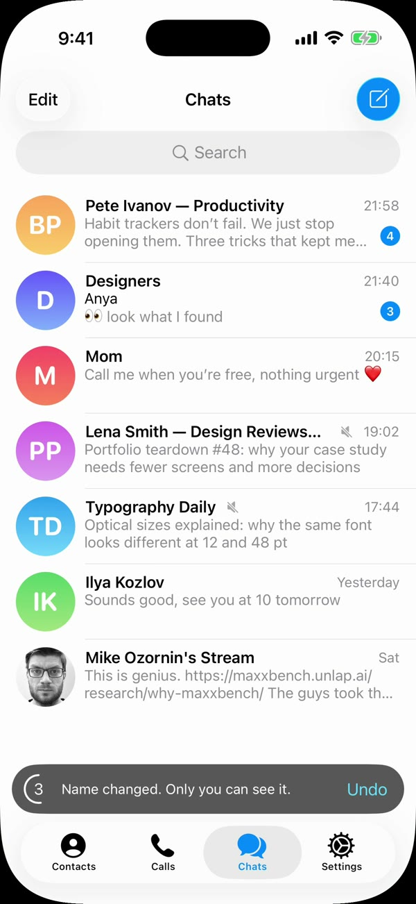

# Rename channels for yourself — Telegram iOS prototype

Rename any channel or group just for yourself. Your name shows up in the chat list, the chat header, search and forwarded posts, while the original name stays in the profile.

By @mikeozornin.

## Demo

[](media/channel-rename-demo.mp4)

[Watch the demo video](media/channel-rename-demo.mp4) (68 s, recorded in the iOS simulator).

## Setup

This repo is meant to live inside a clone of Telegram-iOS:

```sh
git clone --depth 1 https://github.com/TelegramMessenger/Telegram-iOS.git
git clone https://github.com/mikeozornin/telegram-rename-channel.git Telegram-iOS/prototypes/ChannelRename
```

Then the generate, build and run instructions below apply (they use paths relative to the Telegram-iOS root).

## Contents

`html-prototype/channel-rename.html` is the earlier clickable HTML prototype (Russian UI) used to agree on the flow.

# ChannelRename prototype

A standalone iOS app that looks like the current Telegram iOS app (iOS 26 glass design, default day-classic theme)
and demonstrates **renaming someone else's channel or group for yourself only**: a private custom name that only you
see, on all your devices.

No Bazel, no signing, no TelegramCore. The app compiles a handful of real Telegram modules from `submodules/` as
framework targets (see "Telegram sources used") and draws the screens in UIKit with Telegram's metrics.

## Generate, build, run

From the Telegram-iOS root:

```sh
xcodegen generate --spec prototypes/ChannelRename/project.yml
xcodebuild -project prototypes/ChannelRename/ChannelRename.xcodeproj -scheme ChannelRename \
  -destination 'platform=iOS Simulator,name=iPhone Air' \
  -derivedDataPath prototypes/ChannelRename/build build
U=<simulator udid>
xcrun simctl install $U prototypes/ChannelRename/build/Build/Products/Debug-iphonesimulator/ChannelRename.app
xcrun simctl launch $U org.telegram.ChannelRenamePrototype                  # interactive, starts at list.before
xcrun simctl launch $U org.telegram.ChannelRenamePrototype -state rename.edit -kind group
xcrun simctl launch $U org.telegram.ChannelRenamePrototype -demo 1          # autoplay for the video
```

Requires Xcode 26 and an iOS 26.x simulator (deployment target 26.0, iPhone portrait). `build/` and the generated
`.xcodeproj` are git-ignored. `Tools/prepare.sh` regenerates the vendored inputs (see below) after the Telegram
sources change.

## Launch arguments

| Argument | Values | Meaning |
|---|---|---|
| `-state <id>` | see the table below | opens a scenario state directly; the toast a state seeds (`list.after`) stays with a full ring for the screenshot, every later toast times out normally |
| `-kind` | `channel` (default), `group` | the renamed chat is the channel "Beavers & Productivity" (12,480 subscribers) or the group "Beavers & Productivity Chat" (1,204 members) |
| `-demo 1` | | plays the stakeholder scenario automatically |

| State | Screen |
|---|---|
| `list.before` | chat list, no custom name (the default start) |
| `list.menu` | long-press menu on the channel row: Mark as Read, Pin, Rename for me, Mute, Leave Channel |
| `list.after` | chat list with the custom name "Pete Ivanov — Productivity" and the undo toast |
| `list.search` | search "beavers": found by the original name, matches highlighted |
| `list.searchEmpty` | search "beavers winter": No Results |
| `chat.original` / `chat.renamed` | channel (or group) screen; header shows the custom name and the subscriber count |
| `profile.original` / `profile.renamed` | profile; with a custom name: title = custom name, grey line = original name, then the count |
| `profile.more` | the profile's More menu with "Rename for me" |
| `rename.new` / `rename.filled` | "Custom name" screen, empty (placeholder = original name) / typed |
| `rename.edit` / `rename.cleared` | editing an existing custom name (with "Reset to original name") / field cleared |
| `forward.me` | "Designers" group: Anya's forwarded post shows "Forwarded from Pete Ivanov — Productivity" |
| `forward.other` | the same chat as Anya sees it: her outgoing post, header with the original name |

`Tools/seam-scan.sh <video.mp4>` lists frames with solid black wedges in the screen corners (the seam behind a
sliding screen's rounded corners during push/pop; window and navigation backgrounds take the screens' colours so
there is none). `Tools/screenshots.sh <udid> [state ...]` installs the build and saves a screenshot of every state to `Evidence/<state>.png`
(the folder is git-ignored and created locally), plus `-group` variants (`NO_GROUP=1` skips them).

## Interactive behaviour

Everything works by taps: long-press a row for the menu, Rename for me / Edit custom name, typing (max 64 characters:
typing past it does nothing, a longer paste inserts the part that fits; the remaining count shows from 10 left), Done
(disabled while the field shows what you already see; an empty field or exactly the original name resets, with
"Original name restored"), Cancel,
Reset to original name, Undo in the toast (5 s countdown), search (case- and diacritics-insensitive, whitespace tokens
ANDed, a quoted phrase is one token, trimmed, from the first character; matches both the custom and the original
name), back buttons and the interactive back swipe, the chat header → profile, profile Edit and More, and the
forwarded header → the channel.

## Demo mode

`-demo 1` runs, at a calm pace, with a visible finger (a translucent circle) and typing character by character:

1. list (hold) → long-press "Beavers & Productivity" → menu → "Rename for me" → types "Pete Ivanov — Productivity" →
   Done → list with the custom name and the undo toast;
2. search: types "beavers" → found by the original name → close;
3. opens the channel (custom name + subscribers) → taps the header → profile with the original name in grey;
4. back → "Designers" → "Forwarded from Pete Ivanov — Productivity" → taps it → the channel opens → back;
5. channel profile → Edit → clears the field → Done → "Original name restored" → Undo → the custom name is back.

About 65 s. The name and the query are typed into the focused field, so the on-screen keyboard is up while they are
typed. If a lookup the script depends on fails, it logs `DEMO demo.abort <step> <seconds>` and stops. Each step prints `DEMO <step-id> <seconds since start>` to stdout and appends it to
`Documents/demo-timeline.txt` in the app's data container
(`xcrun simctl get_app_container <udid> org.telegram.ChannelRenamePrototype data`). Step ids: `list.before`,
`list.menu`, `rename.new`, `rename.typing`, `rename.filled`, `list.after`, `search.open`, `list.search`,
`search.closed`, `chat.renamed`, `profile.renamed`, `list.back`, `forward.me`, `forward.open`, `list.back2`,
`profile.renamed2`, `rename.edit`, `rename.cleared`, `profile.restored`, `profile.undo`, `demo.end`.

Record: `xcrun simctl io <udid> recordVideo --codec=h264 --force demo.mp4` while it runs. For the keyboard to show,
the simulator must not consider a hardware keyboard attached: Simulator ▸ I/O ▸ Keyboard ▸ "Connect Hardware Keyboard"
off, and no hardware key events sent to it (after `axe type` the device keeps hiding the software keyboard until it
is erased). On a fresh device, open a text field once and dismiss the "slide to type" introduction and any first-run
system alerts (e.g. "“Fitness” Would Like to Send You Notifications") before recording.

## Telegram sources used

Compiled from `submodules/` (unchanged, as framework targets in `project.yml`):

- `AsyncDisplayKit` (`MINIMAL_ASDK`, C++17), `ObjCRuntimeUtils`, `UIKitRuntimeUtils`, `AppBundle`,
  `SSignalKit/SwiftSignalKit`, `Markdown`, `Display` — fonts (`Font`), `UIColor(rgb:)`, `generateImage`,
  `generateTintedImage`.
- `ComponentFlow`, `Components/ComponentDisplayAdapters`, `TelegramUI/Components/MeshTransform(+Api)`,
  `TelegramUI/Components/GlassBackgroundComponent` — `GlassBackgroundView`, Telegram's own glass (native
  `UIGlassEffect` on iOS 26) for every glass button, capsule, panel and menu.
- `TelegramUI/Components/TabBarLayout` + `TelegramUI/Components/LiquidLens` — the tab bar's geometry
  (`tabBarSystemItemsLayout`, `tabBarLensSelectionFrame`) and its liquid-lens selection.
- `GradientBackground` (`-O`, as in its BUILD) — the chat wallpaper's four-colour gradient (classic colours).

Vendored (regenerated by `Tools/prepare.sh`):

- `Vendor/DisplayPatched/ReservedArea.swift`, `WindowContent.swift`: copies of the Display files with their two
  iOS 27.1 SDK calls (`UIView.reservedRegions`, iPhone Duo only) stubbed, so Display builds with the Xcode 26 SDK.
- `Vendor/ModuleMaps`: module maps for the two ObjC modules without umbrella headers.
- `Resources/Assets.xcassets`: only the imagesets listed in `Tools/assets.txt`, copied from
  `submodules/TelegramUI/Images.xcassets` with their namespaces (tab icons, compose, muted, search loupe/clear,
  context-menu icons, profile buttons, chat input and message icons).
- `Resources/EmojiFallback`: Apple emoji rendered on the Mac (`Tools/render-emoji.swift`). The iOS 26.3 simulator
  runtime on the build machine draws missing-glyph boxes for every emoji, so in the simulator the prototype draws the
  five emoji of its data from these images; on a device the system font is used.

Not compilable standalone (they pull in TelegramCore/Postbox/AccountContext): ChatListUI, PeerInfoScreen, ItemListUI,
ContextUI, SearchBarNode, AvatarNode, TelegramPresentationData, NavigationBarNode, TabBarComponent, UndoUI. Their
screens are rebuilt in UIKit from their source metrics, cited in the code comments (file:line).

## Copy

Telegram's strings are used verbatim (`Telegram/Telegram-iOS/en.lproj/Localizable.strings`). New strings of this
feature (sentence case): "Rename for me", "Edit custom name", "Custom name", "Reset to original name",
"Only you will see this name, on all your devices. Subscribers see “…”." (groups: "Members see …"),
"Name changed. Only you can see it.", "Original name restored".

## Known differences from Telegram

- The chat-list long-press preview is a static chat preview (Telegram's is the live chat controller).
- The "No Results" state has no animated duck sticker (no Lottie in this build).
- Search results highlight matched text in the accent colour; Telegram's peer rows have no highlight (asked for).
- Profile header buttons use static icons instead of Lottie; the menu entrance is a spring approximation.
- The classic wallpaper is the gradient only, without its pattern.

## License

This prototype is published under the GNU General Public License v2 (see LICENSE). It contains copies of a few source files and icons from Telegram-iOS (https://github.com/TelegramMessenger/Telegram-iOS), which remain subject to that project's terms.
